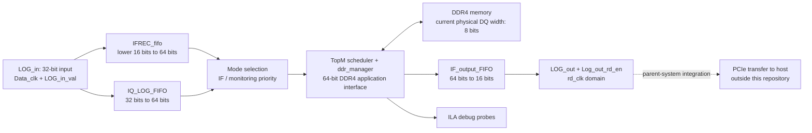

# DDR4 I/Q Data Logger

An FPGA acquisition and DDR4 buffering subsystem for an I/Q data logger with a PCIe host-transfer path in the surrounding system. The VHDL handles sample buffering, DDR4 write/read scheduling, monitoring control, and readback through a separate consumer clock domain.

**Project contribution:** I implemented an I/Q data logger with DDR4 buffering and PCIe transfer to a host. I integrated the acquisition, memory, and transfer functions and supported system debugging and testing.

This repository contains the acquisition and DDR4 subsystem. The PCIe endpoint/DMA logic, host application, and board-level integration wrapper are outside this source snapshot.

## Architecture



The two input FIFOs receive samples in parallel whenever `LOG_in_val` is asserted. IF logging uses `LOG_in(15 downto 0)`; I/Q logging preserves all 32 input bits. The RTL does not assign I and Q bit fields or define signedness; those conventions belong to the upstream acquisition interface.

The scheduler selects one FIFO for DDR4 writes. Read data returns through a 64-to-16-bit FIFO for consumption by the external transfer logic. This interface uses explicit FIFO read enables and an occupancy flag; it does not implement AXI-Stream framing or a PCIe protocol.

## Repository layout

```text
HDL/
  TopM.vhd                 Acquisition FIFOs, scheduler, monitoring, output and ILA
  ddr_manager.vhd          DDR4 native application-interface wrapper
IP/
  ddr4_0.xcix              DDR4 controller IP container
  IFREC_fifo.xcix          IF acquisition FIFO
  IQ_LOG_FIFO.xcix         I/Q acquisition FIFO
  IF_output_FIFO.xcix      Readback FIFO
  ila_0.xcix               Integrated Logic Analyzer
Prj/
  DDR4_DataLogger.xpr      Vivado project; top-level entity: TopM
.gitattributes             Text line-ending and binary-container handling
.gitignore                 Generated Vivado outputs and local files
README.md                  Project description and integration notes
```

The `.xcix` files contain the vendor IP configurations and packaged products. Keep them alongside the VHDL and project file. The saved project also records paths to unpacked `.xci` files under `IP/<core-name>/`; those working copies are supplied by the containers rather than tracked separately. Vivado work directories, run outputs, journals, and caches are excluded from Git; existing local outputs are preserved on disk.

## RTL operation

### Capture modes

| Mode | Selection | Behavior |
| --- | --- | --- |
| IF logging | `LOG_EN = 1` | Store the lower 16 bits of each valid input sample. |
| I/Q logging | `IQ_EN = 1`, with IF/monitoring selection inactive | Store each complete 32-bit input word. |
| Monitoring | `Monitoring_Log_Start = 1` | Select the IF FIFO for writes. |
| Hold and release | `MaxHold_Monitoring_EN = 1` | Fill the requested capture, then wait for release before readback begins. |

`LOG_EN` or `Monitoring_Log_Start` takes precedence over `IQ_EN` in both data and write-trigger selection. Both acquisition FIFOs are popped during a DDR4 write, regardless of the selected source. Idle drain conditions depend on the mode enables; these enables do not gate FIFO input writes.

### Memory scheduling

- `s_idle` prioritizes a write when the selected input FIFO reaches its programmable-full threshold and the capture limit has not been reached.
- `s_write` accepts 512 transfers of 64 bits each: one scheduler block carries 4096 payload bytes. The application address increases by 8 for each accepted transfer.
- `s_read` issues 512 read commands and advances the read address by 8 per accepted command. Returned data is captured independently whenever `valid_rd` is asserted.
- Normal readback starts when stored blocks remain and the output FIFO reports empty. Hold mode defers readback until capture completes and the monitoring release/busy condition permits it.

The block size above is the scheduler's transaction group, not the DDR4 device's physical burst length.

`LOG_buffer_count` counts completed write blocks; `RD_buffer_count` counts completed blocks of issued read commands. The current comparison permits **`IQ_Buffer_length + 1` blocks**, rather than interpreting `IQ_Buffer_length` as a sample or byte count. For example, a stable value of 3 permits four blocks, or 16 KiB of payload. Keep the control value within the configured memory range and avoid 32-bit overflow in the `+ 1` expression.

Addresses progress linearly during a capture. The RTL does not implement circular-buffer wraparound. In idle, clearing `LOG_EN`, `IQ_EN`, and `MaxHold_Monitoring_EN` clears the capture counters and addresses and drains the output FIFO.

### Clocks, reset and output

| Signal | Role |
| --- | --- |
| `clk_in_p`, `clk_in_n` | Differential clock input to the DDR4 controller. The packaged IP specifies a 5000 ps input period. |
| `Data_clk` | Acquisition FIFO write clock. |
| `clk_ddr` | Internal DDR4 UI clock used by the scheduler and FIFO memory-side ports. |
| `rd_clk` | External consumer's output FIFO read clock. |
| `Glb_rst` | Passed to the DDR4 IP's `sys_rst`. |
| `Reset` | Drives FIFO resets; it does not directly reset the scheduler. |
| `clk_sync_rst` | DDR4 UI synchronous reset used by the scheduler. |
| `refclk`, `gtx_clk`, `s_axi_aclk`, `clk_20M` | Requested auxiliary clock outputs; see the IP mismatch below. |

`IF_Data_rdy` mirrors the output FIFO's `prog_full` flag. It is an occupancy threshold, rather than a per-cycle data-valid signal. The output IP uses `Standard_FIFO` mode, so the consumer must account for its configured read latency. When capture and monitoring are disabled, the RTL forces reads to drain the output FIFO.

`IF_Monitoring_Data_Ready` indicates that captured blocks remain available in hold mode. `IF_Monitoring_Busy` tracks the monitoring release/readback sequence. Although these ports are declared `inout`, this RTL drives them; the parent wrapper should avoid competing drivers.

### Packaged FIFO configurations

| IP | Input width / depth | Output width / depth | Read mode | Programmable-full assertion |
| --- | --- | --- | --- | --- |
| `IFREC_fifo` | 16 bits / 16384 words | 64 bits / 4096 words | First-word fall-through | 2048 input words |
| `IQ_LOG_FIFO` | 32 bits / 4096 words | 64 bits / 2048 words | First-word fall-through | 1024 input words |
| `IF_output_FIFO` | 64 bits / 2048 words | 16 bits / 8192 words | Standard FIFO | 512 input words |

The input FIFO thresholds each correspond to 512 packed 64-bit words. These values come from the configurations inside the supplied IP containers.

## Vivado project

The saved project identifies **Vivado 2025.2**, targets **`xcku060-ffva1156-1-c`**, and uses `TopM` as its top-level entity. The VHDL retains the original `std_logic_arith` and `std_logic_unsigned` packages.

To inspect the project:

1. Open `Prj/DDR4_DataLogger.xpr` in Vivado, preferably the saved version.
2. Check that both VHDL files and all five IP containers resolve from the repository-relative paths.
3. Inspect IP Status and the DDR4 configuration before regenerating products or upgrading IP.
4. Resolve the integration items below before attempting a board build.

No simulation step is required for reviewing the source or documentation. Board synthesis, implementation and programming require a completed hardware wrapper and constraints.

## Hardware reference and integration items

The supplied **ALINX AXKU062 User Manual**, file `1_AXKU062_User_Manual.pdf`, describes an `XCKU060-2FFVA1156I` FPGA, four Micron `MT40A512M16LY-062EIT` devices forming a 64-bit DDR4 bus, a 200 MHz differential oscillator, and a PCIe Gen3 x8 interface. Relevant sections are Part 1.1-1.3, Part 1.5, and Part 2.2. The manual is an external hardware reference and is not bundled here.

The current source snapshot requires the following integration work before it represents a complete AXKU062 build:

| Item | Current state / required reconciliation |
| --- | --- |
| FPGA part | The project selects speed grade `-1`, commercial; the manual specifies `-2`, industrial. Confirm the physical device before changing the target. |
| DDR4 interface | RTL and IP use an 8-bit physical DQ bus and a 64-bit application data bus. The manual's board memory bus is 64 bits wide. Match the IP and wrapper to the actual board wiring. |
| Memory component | The IP selects `MT40A512M16LY-075`; the manual lists `MT40A512M16LY-062EIT`. Reconcile part and timing settings. |
| Auxiliary clocks | `ddr_manager` declares/maps `addn_ui_clkout1` through `addn_ui_clkout4`, but the packaged DDR4 IP has all four frequencies set to `None` and omits these ports. Align the component declaration and clock generation with the intended design. |
| Board constraints | The project's user constraint set is empty. No board-level pin assignment or integration clock constraints are supplied. |
| PCIe and host | Add the parent transfer wrapper, endpoint/DMA configuration and host software for an end-to-end system. |
| Clock-domain control | Input/output FIFOs bridge data clocks. Mode controls and monitoring release are consumed directly in the DDR clock domain; the output FIFO empty flag is also used there. Review synchronization and flag timing in the parent design. |
| FIFO flow control | FIFO full and reset-busy outputs are left unconnected. Coordinate acquisition, reset and consumer pacing externally to prevent dropped samples or invalid reads. |
| Legacy reset path | `s_resetCycle` has no incoming transition, and `rst_auto` has no assignment in the normal reset path. It is ORed into the IF FIFO reset and needs a defined reset strategy during functional integration. |

These existing settings and behaviors were preserved during the documentation cleanup.

## Debugging and validation status

The `ila_0` instance samples 16 probes on `clk_ddr`, with a configured capture depth of 1024. Probes cover scheduler state, read/write addresses, selected write data, IF FIFO output, write readiness, monitoring controls/status, read-data validity/data, block size configuration and counters. Some observed controls originate outside the DDR clock domain, so interpret those probes with their synchronization context in mind.

The project work included system debugging and testing as described in the contribution above. This snapshot does not include measured throughput, timing-closure evidence or an end-to-end hardware test report.

For this cleanup, executable VHDL tokens were compared against the original files and remained unchanged. Source paths, IP container metadata and documentation were checked statically. **No simulation, synthesis, implementation or hardware test was run as part of this cleanup.**

## GitHub contents

Commit the VHDL, IP containers, `.xpr`, README and repository configuration files. Generated Vivado directories and logs are ignored without deleting local build results. The existing directory layout and source references are retained so the saved project continues to point to the same files.

Vendor IP retains its original notices and license terms. No additional project license has been selected in this snapshot.
